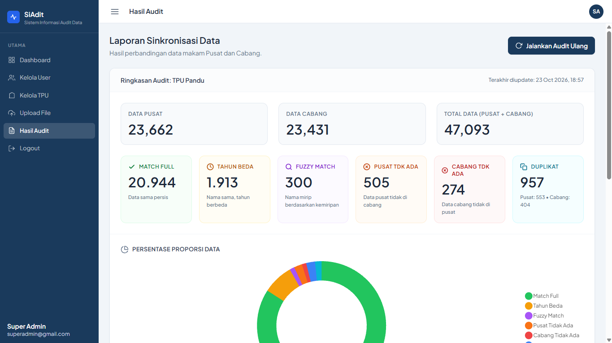
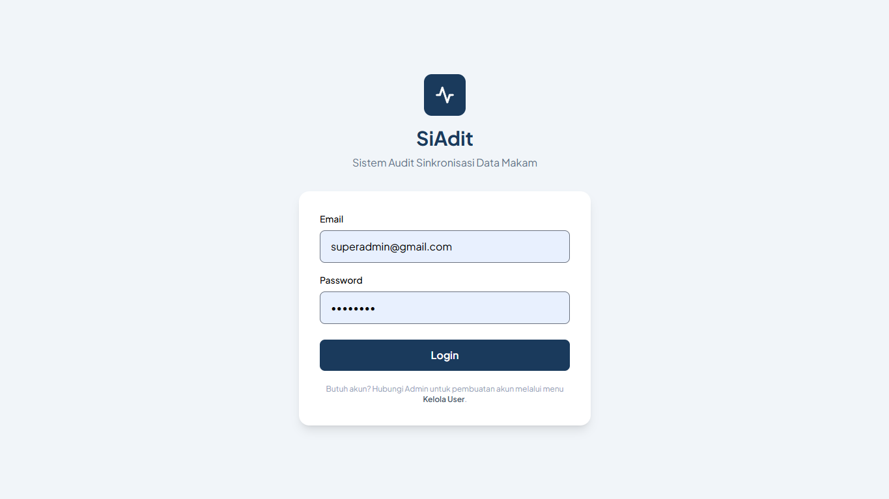
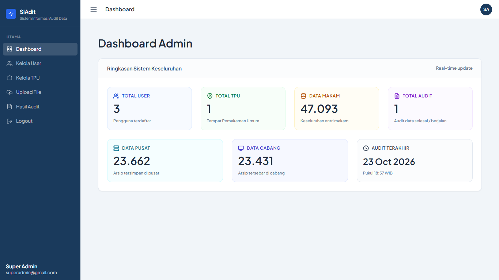
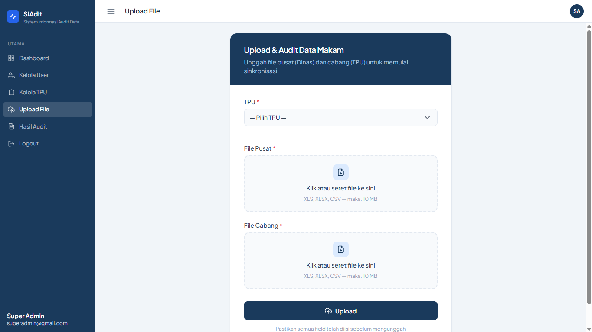
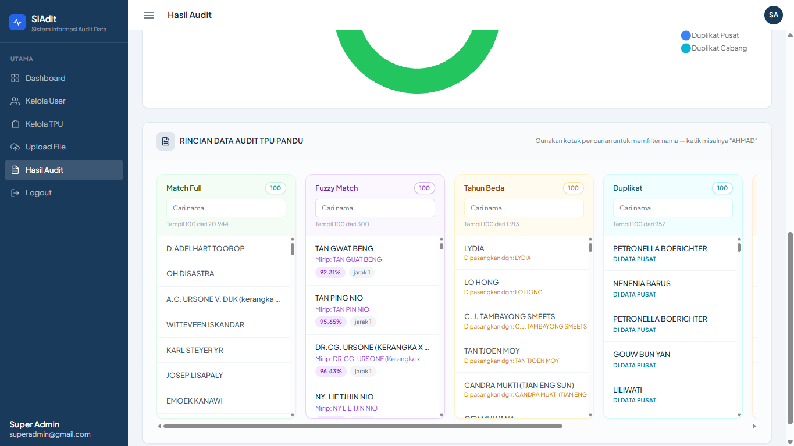
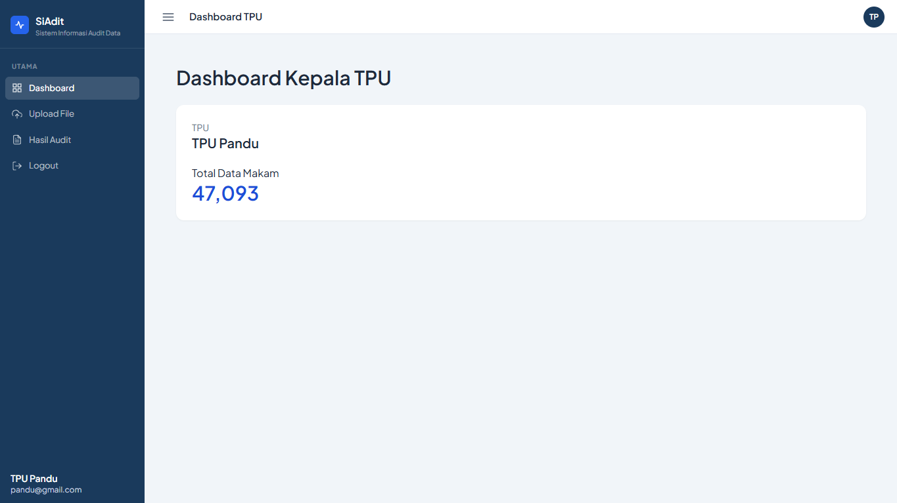
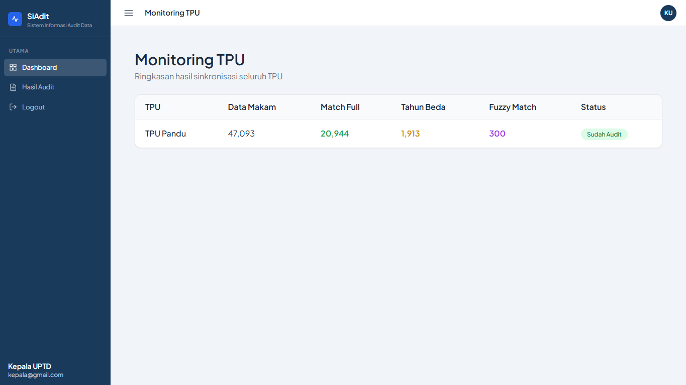
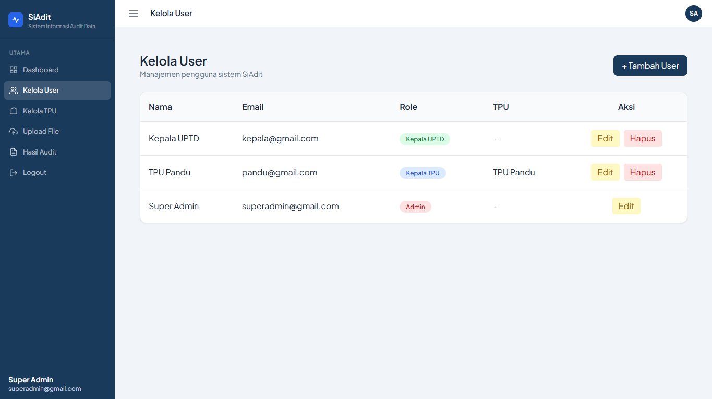
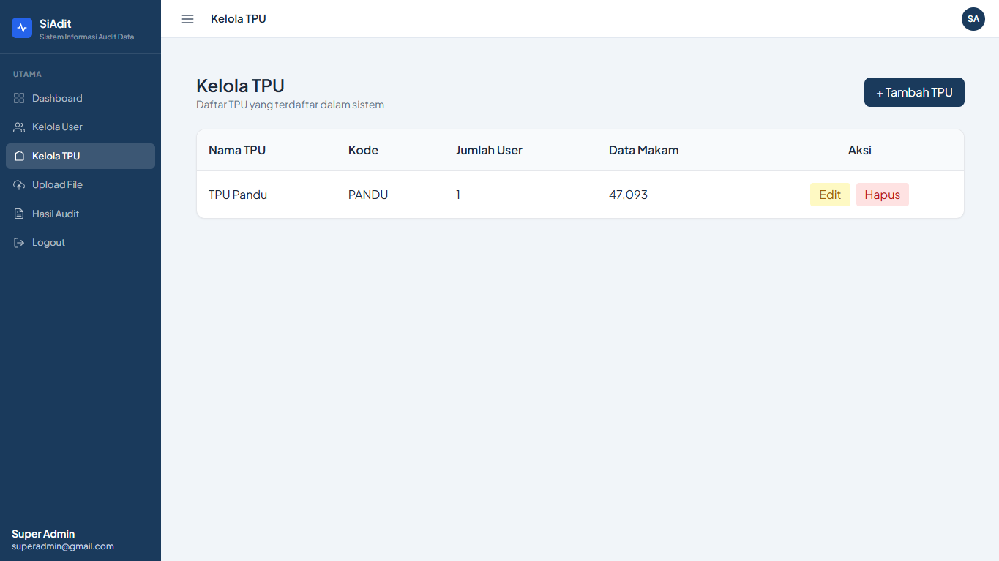

# SiAdit — Sistem Informasi Audit Data Pemakaman


<p align="center">
  
</p>

**SiAdit** adalah aplikasi web internal untuk mengaudit dan merekonsiliasi data pemakaman
**TPU Pandu** — membandingkan data pemakaman yang diserahkan **Dinas** (data pusat) dengan
catatan pencatatan di **TPU** yang bersangkutan (data cabang). Dibangun selama program magang
di **Dinas Cipta Karya & Tata Ruang (BTKR) Kota Bandung**.

Sumber datanya dua file Excel, masing-masing berisi lebih dari 23 ribu baris, yang selama
ini dicocokkan secara manual di Excel dengan VLOOKUP dan COUNTIF. SiAdit mengambil alih seluruh
proses itu: pembersihan data, pencocokan otomatis (termasuk nama mirip yang tidak persis
sama), deteksi duplikat, hingga laporan hasil yang bisa difilter dan dicari per kategori.

---

## 🎯 Permasalahan yang Diselesaikan

1. **Pencocokan manual 47 ribu baris** di Excel: lambat, rawan salah, dan tanpa jejak
   yang bisa ditelusuri kembali.
2. **Format tanggal tidak baku antarfile**: serial Excel, `dd/mm/yyyy`, `yyyy-mm-dd`,
   bahkan nilai `0000-00-00` yang oleh PHP diterjemahkan menjadi tanggal **tahun -0001**
   sehingga menggagalkan seluruh proses impor di tengah jalan.
3. **Pencocokan ganda (double-claim) di Excel**: satu baris data cabang ikut jadi pasangan
   untuk dua baris data pusat yang berbeda, sehingga laporan "cocok" bisa menyesatkan.
4. **Nama mirip tetap harus ditemukan**: ejaan yang berjarak satu-dua huruf
   (`AHMAD SA` vs `AHMAD SAA`) tidak akan pernah cocok lewat VLOOKUP biasa.
5. **Satu file Excel dipakai bersama antarpetugas** tanpa pembagian peran yang jelas:
   siapa yang mengunggah, siapa yang hanya melihat hasil, siapa yang mengurus master data.

## 💡 Solusi: Mesin Audit Tiga Tahap

Untuk setiap baris data pusat, pencarian pasangan dilakukan berurutan dari yang paling
spesifik: begitu ditemukan di satu tahap, jalur pencarian berikutnya tidak dibuka lagi —
dan **seluruh jalur hanya boleh mengklaim baris cabang yang belum berpasangan**, sehingga
satu baris cabang tidak mungkin dipakai dua kali.

| Tahap | Kondisi pencocokan | Status hasil |
|---|---|---|
| 1 | `id_match` (nama - tahun) sama persis | Match Full |
| 2 | Nama bersih sama, tahun berbeda | Tahun Beda |
| 3 | Nama mirip (Levenshtein ≤ 3 *dan* kemiripan ≥ 90%) | Fuzzy Match |
| 4 | Tidak ditemukan kecocokan di data cabang | Pusat Tidak Ada |
| 5 | Baris cabang yang tidak mendapat pasangan pusat | Cabang Tidak Ada |
| 6 | `id_match` muncul lebih dari sekali dalam satu sumber | Duplikat Pusat / Cabang |

> Catatan: `id_match` dibentuk dari nama + tahun — data pusat memakai **tahun meninggal**,
> data cabang memakai **tahun pemakaman** (mengikuti kolom yang memang tersedia di masing-masing file). Karena itu, pasangan dengan nama sama namun tahun berbeda sangat wajar: statusnya Tahun Beda.

Pencocokan memakai `nama_clean` hasil penormalan `CleaningService` (huruf besar seragam,
tanpa titik dan tanda baca). Tanggal dibaca `MatchingService` dari serial angka Excel,
`dd/mm/yyyy`, `yyyy-mm-dd`, hingga teks bebas — dan tanggal nol dianggap "tanpa tanggal",
sehingga tidak pernah memproduksi tahun absurd seperti kasus di atas.

## ✨ Fitur Utama

- **Impor dua file sekali jalan** dengan semantik *replace* per sumber: data lama dihapus
  lalu diimpor ulang **dalam satu transaksi** (semua-atau-tidak-sama-sekali), dan hasil audit
  lama ikut di-reset bersih — tidak ada kemungkinan data setengah jadi.
- **Hasil audit interaktif**: pencarian instan per kategori tanpa reload, chart donut
  proporsi kategori, serta skor kemiripan dan jarak Levenshtein pada tiap pasangan Fuzzy Match.
- **Ekspor hasil audit ke Excel**: satu tombol mengunduh satu berkas `.xlsx` — lembar
  Ringkasan ditambah enam lembar detail yang memuat seluruh baris tiap kategori (bukan
  hanya 100 baris seperti tampilan layar), siap dilampirkan ke laporan.
- **Multi-role**: `admin` (kelola user & master TPU), `kepala_tpu` (unggah file),
  `kepala_uptd` (monitor hasil) — menu dan halaman disesuaikan per role.
- **Pekerjaan berat ditaruh di CLI**: data lebih dari ±50 ribu baris diblok dari web dan
  dialihkan ke perintah `siadit:import-excel` / `siadit:generate-audit` agar aman dari timeout.
- **Kinerja dataset besar**: bulk insert 1.000 baris per batch, indeks database, dan hanya
  kolom yang benar-benar dipakai yang dimuat — audit 47 ribu baris selesai ±20 detik.
- **50 test otomatis** (unit + fitur), termasuk regresi untuk kasus nyata:
  tanggal nol, data duplikat, dan pencocokan ganda.

## 📊 Hasil pada Data Nyata (TPU Pandu)

Data yang diaudit: **23.662 baris pusat** (rentang 1900–2026) dan
**23.431 baris cabang** (rentang 1928–2026).

| Kategori | Jumlah |
|---|---:|
| Match Full | 20.944 |
| Tahun Beda | 1.913 |
| Fuzzy Match | 300 |
| Pusat Tidak Ada | 505 |
| Cabang Tidak Ada | 274 |
| Duplikat Pusat | 553 |
| Duplikat Cabang | 404 |

- Tingkat sinkronisasi: **88,5% baris pusat** memiliki pasangan pasti di data cabang.
- Konsistensi terverifikasi lewat SQL: 23.157 pasangan = 23.157 `matched_with` unik
  (tidak ada satu baris cabang pun dipakai dua kali), dan sisa 274 baris cabang dipetakan
  tepat ke kategori Cabang Tidak Ada.
- Waktu proses: impor **±129 detik**, audit **±19–21 detik** — pada versi lama, audit
  188 ribu baris bisa tersangkut ±5 menit dan tidak pernah tuntas.

## 🧪 Temuan Teknis yang Menarik

- **Teks `0000-00-00` bukan tanggal nol biasa**: PHP mengira nilainya tanggal **tahun -0001**,
  MySQL menolaknya (`SQLSTATE[22007]`), dan seluruh transaksi tergulung ke data lama.
  Solusi: tanggal nol dan serial ≤ 0 diperlakukan sebagai "tanpa tanggal" (tahun `0000`
  pada `id_match`), plus dua test regresi khusus.
- **Pencocokan ganda tersembunyi**: angka ringkasan terlihat "pas" semua, tapi SQL
  menunjukkan 57 baris cabang dipakai dua kali lintas status. Perbaikannya bukan menambal
  satu per satu, melainkan menata ulang mesin audit menjadi rekonsiliasi sekuensial
  dengan penjaga "kandidat belum dipakai" (`ambilKandidatBelumDipakai`) di semua jalur.
- **Fuzzy matching 47 ribu baris tak harus O(n²)**: kandidat dikelompokkan berdasarkan
  panjang nama (Levenshtein ≤ 3 hanya mungkin antara nama yang panjangnya tidak lebih dari
  3 karakter), dan jarak Levenshtein yang murah dihitung lebih dulu sebelum `similar_text`.

## 🖼️ Tampilan Aplikasi

| Halaman login | Dashboard admin |
|---|---|
|  |  |

| Unggah file pusat & cabang | Rincian hasil audit |
|---|---|
|  |  |

| Dashboard kepala TPU | Monitoring kepala UPTD |
|---|---|
|  |  |

| Kelola user | Kelola TPU |
|---|---|
|  |  |

## 🛠️ Teknologi

| Teknologi | Peran |
|---|---|
| [Laravel 13](https://laravel.com) · PHP 8.3 | Kerangka aplikasi, Eloquent, migrasi, CLI |
| [MySQL 8](https://www.mysql.com) | Penyimpanan data, transaksi ketat, indeks |
| [maatwebsite/excel](https://laravel-excel.com) (PhpSpreadsheet) | Pembaca Excel multi-format |
| [Tailwind CSS](https://tailwindcss.com) + [Vite](https://vitejs.dev) | Antarmuka & build aset |
| [Chart.js](https://www.chartjs.org) | Grafik proporsi hasil audit |
| [Laravel Breeze](https://laravel.com/docs/starter-kits) | Otentikasi & profil pengguna |
| [PHPUnit](https://phpunit.de) | 50 test otomatis (unit + fitur) |

## 🚀 Cara Menjalankan

**Prasyarat:** PHP ≥ 8.3 (dengan ekstensi `pdo_mysql`), Composer, Node.js, dan MySQL 8.

```bash
# 1. Kloning & masuk direktori proyek
git clone https://github.com/Rayshan10/SiAdit.git
cd SiAdit

# 2. Pasang dependensi
composer install
npm install
npm run build

# 3. Salin konfigurasi, buat app key, atur koneksi MySQL di .env
cp .env.example .env
php artisan key:generate

# Di .env, sesuaikan nilai berikut:
#   DB_CONNECTION=mysql    DB_DATABASE=audit
#   DB_USERNAME=root       DB_PASSWORD=

# 4. Migrasi + seed (mengisi daftar TPU contoh: PANDU, CIKADUT, NAGROG, dst.)
php artisan migrate --seed

# 5. Jalankan aplikasi
php artisan serve
```

Aplikasi tidak menyediakan pendaftaran mandiri — agar mengikuti alur kerja dinas,
akun dibuat oleh admin lewat menu **Kelola User**. Untuk **akun admin pertama**:

```bash
php artisan tinker
>>> App\Models\User::create([
...     'name'     => 'Super Admin',
...     'email'    => 'admin@example.com',
...     'password' => bcrypt('password'),
...     'role'     => 'admin',
... ]);
```

### Alur pemakaian

1. Menu **Upload File**: pilih TPU, unggah **File Pusat** (Dinas) dan **File Cabang** (TPU).
   Impor berjalan dalam satu transaksi dan otomatis menggantikan data lama per sumber.
2. Menu **Hasil Audit**: klik **Jalankan Audit** — setelah ±20 detik, ringkasan, chart, dan
   tabel rincian audit tampil lengkap dengan pencarian nama per kategori. Tombol
   **Unduh Excel** di panel ringkasan mengunduh seluruh hasil audit sebagai berkas Excel.
3. Untuk data di atas ±50 ribu baris, gunakan CLI:

```bash
# Impor dua file Excel (menggantikan data lama TPU yang dimaksud)
php artisan siadit:import-excel PD pusat.xlsx cabang.xlsx

# Audit satu TPU (ID atau KODE) — dianjurkan untuk dataset besar
php artisan siadit:generate-audit PD --force
```

> Kode `PD` di atas adalah KODE TPU contoh dari seeder; daftar lengkap bisa dilihat
> di menu **Kelola TPU** atau dari keluaran perintah CLI bila kode tidak ditemukan.

## 📁 Struktur Kode Penting

```
app/
├── Console/Commands/
│   ├── ImportExcelCommand.php      # siadit:import-excel — impor via CLI (dataset besar)
│   └── GenerateAuditCommand.php    # siadit:generate-audit — audit via CLI (dataset besar)
├── Http/Controllers/
│   ├── UploadController.php        # unggah dua file Excel via web
│   ├── AuditController.php         # halaman hasil audit + guard dataset besar
│   ├── UserController.php          # kelola user (admin)
│   └── TpuController.php           # kelola TPU (admin)
├── Imports/DataMakamImport.php     # pembaca baris Excel + rantai fallback tanggal
└── Services/
    ├── AuditService.php            # mesin rekonsiliasi tiga tahap anti double-claim
    ├── MatchingService.php         # id_match (nama-tahun) + pembaca tanggal aman
    ├── CleaningService.php         # penormalan nama (softNormalize)
    └── ImportMakamService.php      # orkestrator impor ganti-data (satu transaksi)
```

## 📄 Catatan

- Proyek ini adalah **pekerjaan magang nyata** pada data nyata, dikerjakan dengan izin
  Dinas Cipta Karya & Tata Ruang Kota Bandung, lalu dipublikasikan sebagai portofolio.
- Nama yang tampil di screenshot adalah data pemakaman publik pada TPU yang bersangkutan.
- File Excel sumber (data pusat & cabang) tidak disertakan di repositori ini.

---

Dibuat oleh [**Rayshan10**](https://github.com/Rayshan10) — program magang
Dinas Cipta Karya & Tata Ruang (BTKR) Kota Bandung, TPU Pandu, 2026.
